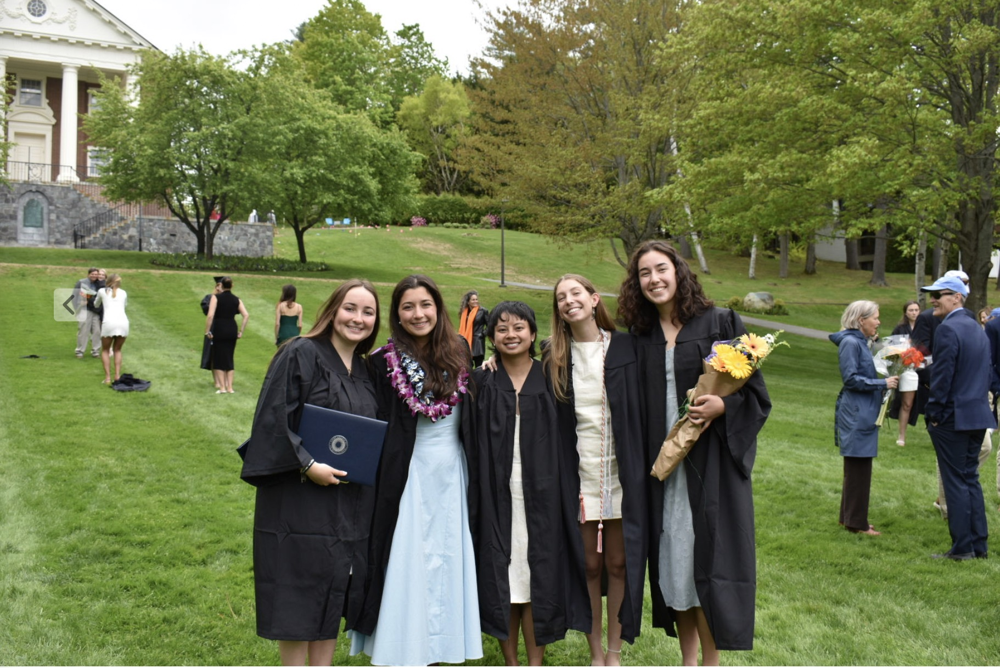
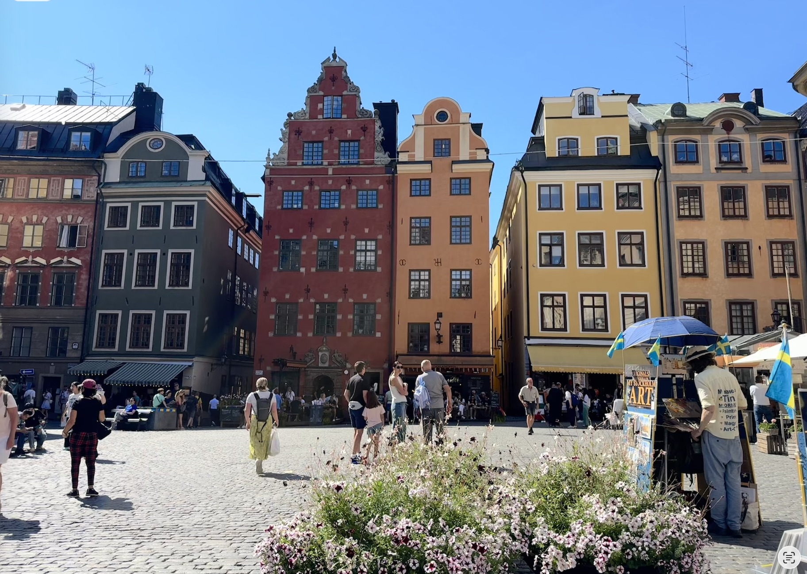
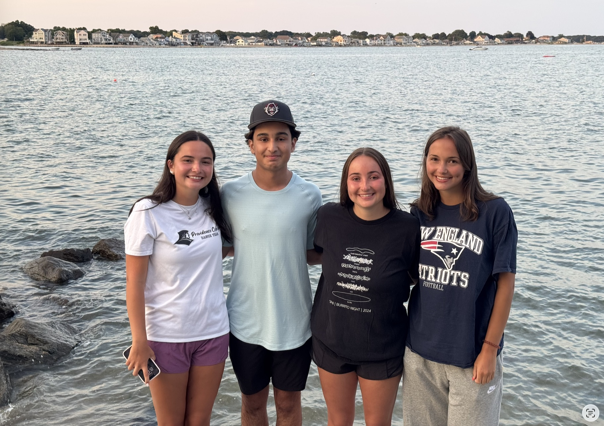

# Welcome and Introduction  

Welcome to a website that's all about Sophie. First things first, lets get excited. 

# Some fun facts about me

I went to undergrad at Colby College in Maine 

I studied abroad in Stockholm Sweden and I loved it 

I have 3 younger siblings 

# Some links to some sites about me 

[My GitHub](https://github.com/SophieGakis) 

[My Email](mailto:sig2127@cumc.columbia.edu)

[My LinkedIn](https://www.linkedin.com/in/sophie-gakis/)

# A page about my academic and professional experience

[Resume](resume_page.html) 

# A page with a flexdashboard for the NYC Restaurant Inspections 

[Flexdashboard](plotly.html)

